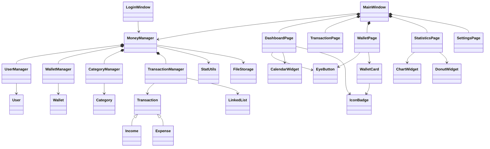

# Giải thích kiến trúc và bảo vệ đồ án PBL2

Ứng dụng dùng C++17 cho nghiệp vụ và Qt 6 Widgets cho giao diện. `src/core/` biên dịch thành thư viện `core` độc lập; `src/ui/` gọi `MoneyManager` và trình bày dữ liệu. `tests/test_console.cpp` kiểm tra core mà không cần Qt.

## Sơ đồ lớp hiện tại

`LinkedList<T>` cài đặt danh sách liên kết đơn và selection sort. `TransactionManager` sở hữu các đối tượng `Transaction*` trong danh sách chính; danh sách lọc chỉ tham chiếu đến chúng. `Income` và `Expense` ghi đè `getSignedAmount()`, nên số dư ví được cập nhật đúng dấu. `FileStorage` đọc/ghi dữ liệu văn bản; `UserManager` quản lý xác thực.

## Cấu trúc phân tầng thực tế
Chương trình được tổ chức theo 5 tầng phân định rõ trách nhiệm:
1. **Tầng Giao diện (UI)** (66 file): Cửa sổ chính `MainWindow`, `LoginWindow`, các trang `pages` (Tổng quan, Giao dịch, Ví tiền, Thống kê, Cài đặt), các hộp thoại `dialogs` và các thành phần tự vẽ / custom `widgets`.
2. **Tầng Điều phối trung tâm (`MoneyManager`)**: Cầu nối duy nhất giữa giao diện và các module nghiệp vụ, chịu trách nhiệm tiếp nhận yêu cầu từ UI và ủy quyền cho các Manager chuyên trách.
3. **Tầng Quản lý nghiệp vụ chuyên trách (`Managers`)**:
   - `UserManager`: Xác thực tài khoản, đăng ký, đăng nhập và đổi mật khẩu. Mật khẩu lưu nguyên văn (plain text) trong `users.dat` (đây là giới hạn đã biết trong phạm vi đồ án học phần năm 2).
   - `WalletManager`: Quản lý danh sách ví, cập nhật số dư, nạp/rút tiền.
   - `CategoryManager`: Quản lý danh mục gắn liền với nghiệp vụ giao dịch, tìm hoặc tạo tự động khi lưu giao dịch.
   - `TransactionManager`: Quản lý giao dịch, sắp xếp theo ngày qua Selection Sort, kiểm soát bất biến không âm qua dòng thời gian.
4. **Tầng Mô hình & Cấu trúc dữ liệu (`Models & Structure`)**:
   - Các thực thể: `User`, `Wallet`, `Category`, `Transaction` (`Income` / `Expense`).
   - Cấu trúc dữ liệu tự cài đặt: `LinkedList<T>` và giải thuật Selection Sort.
5. **Tầng Lưu trữ tập tin (`FileStorage`)**: Đọc và ghi các file văn bản `.dat` tuần tự theo định dạng phân tách trường bằng ký tự `|`. Khi đọc file, các dòng hỏng (thiếu trường, sai dữ liệu) sẽ được tự động bỏ qua để đảm bảo an toàn, không làm ứng dụng bị dừng đột ngột. Chương trình không sử dụng cơ sở dữ liệu ngoài.

## Quy ước mã nguồn

API hiện có và các slot `on_<objectName>_<signal>` giữ tên ổn định để Qt và các trang gọi được. Hàm nội bộ gần nghiệp vụ có thể dùng tiếng Việt không dấu, chẳng hạn `cungThangNam`, `congChiDanhMuc`, `ngayTangDan`; tên lớp và thuật ngữ Qt/C++ vẫn dùng tiếng Anh. Tên hàm mô tả đúng một việc, tham số có nghĩa rõ ràng. Chú thích giải thích quy tắc hoặc quyền sở hữu bộ nhớ, không lặp lại từng dòng lệnh.

Mỗi module nghiệp vụ trong `src/core/` được tổ chức tinh gọn theo đúng chuẩn OOP với 1 cặp file `.h` và `.cpp` (ví dụ `MoneyManager`, `TransactionManager`, `WalletManager`, `CategoryManager`, `UserManager`, `FileStorage`, `utils`). Định dạng tệp dữ liệu dùng `struct RecordFields` và hàm `tachTruong()` ngay trong `file_storage.h/.cpp` phục vụ ca kiểm thử trong `tests/test_console.cpp`. Danh mục được chọn hoặc tự tạo khi lưu giao dịch. Giao dịch được sắp xếp theo ngày, mặc định mới nhất lên đầu qua Selection Sort. Khi sửa giao dịch, kiểm tra ví và loại danh mục trước khi tạo danh mục mới. Sửa giao dịch không đổi loại (muốn đổi loại giao dịch, người dùng xóa và thêm giao dịch mới). `TransactionManager::applyToWallet` dùng `getSignedAmount()` của `Income`/`Expense` để cộng hoặc trừ số dư. Bất biến nghiệp vụ: mọi thao tác thêm/sửa/xóa giao dịch đều qua bộ kiểm tra lịch sử (`validateWalletTimeline`), từ chối nếu làm số dư bất kỳ ví nào âm ở bất kỳ mốc thời gian nào.

Core tự cài `LinkedList` và Selection Sort cho phần cấu trúc dữ liệu của đồ án. Đọc file có tối đa bảy trường nên dùng mảng cố định `RecordFields`, không cần `std::vector`. Thư viện chuẩn còn dùng cho chuỗi, file, thư mục, ngày giờ và định dạng; giao diện cần Qt Widgets, Qt Designer và QPainter. Không thêm thư viện giao diện ngoài Qt.

## Bốn tính chất hướng đối tượng trong mã

| Tính chất | Vị trí |
|---|---|
| Đóng gói | `src/core/model/transaction.h:15` (`private`), `src/core/model/transaction.h:32` (getter/setter) |
| Kế thừa | `src/core/model/transaction.h:54` (`Income : public Transaction`), `src/core/model/transaction.h:66` (`Expense : public Transaction`) |
| Đa hình | `src/core/model/transaction.h:30` (destructor ảo), `src/core/model/transaction.h:46` (virtual), `src/core/manager/transaction_manager.h:12` (`Transaction*`) |
| Trừu tượng | `src/core/model/transaction.h:46`, `src/core/model/transaction.h:50` (hai phương thức thuần ảo) |

## Luồng thêm giao dịch kèm tạo danh mục

1. `TransactionPage` mở `TransactionDialog`, nhận loại giao dịch, ví, ngày, tiền và tên danh mục.
2. Trang tạo `Income` hoặc `Expense`, gọi `MoneyManager::addTransaction(tx, categoryName, categoryType)`.
3. `MoneyManager` kiểm tra con trỏ, tiền, ngày, ví và tên danh mục; sau đó gọi `CategoryManager::findOrCreateCategory`. Tên đã có cùng loại thì dùng lại, tên mới hợp lệ thì tạo danh mục.
4. `TransactionManager::addTransaction` kiểm tra loại danh mục, cập nhật số dư ví theo `getSignedAmount()` rồi lưu giao dịch vào danh sách.
5. Trang gọi `saveAll` và làm mới các trang. Nếu lời gọi thêm thất bại, trang giải phóng `tx`.

## Luồng thống kê dùng chung hàm

`DashboardPage::updateCards` và `StatisticsPage::updateCards` đều gọi `MoneyManager::getMonthlyTotals`. Hàm bọc này gọi `StatUtils::getMonthlyTotals` với danh sách giao dịch hiện hành. `StatUtils::getExpenseByDay` và thống kê danh mục dùng cùng `cungThangNam` với hàm tổng tháng, chỉ cộng khoản chi vào 31 ô ngày và để các ngày thừa bằng 0. Biểu đồ 6 tháng gọi `get6MonthsStats`, mỗi tháng cũng đi qua `getMonthlyTotals`; thống kê danh mục dùng tổng chi từ hàm đó để tính tỷ trọng.

Thanh menu ngang gồm Tổng quan, Giao dịch, Ví tiền, Thống kê và Cài đặt; cả năm nút có `role=nav` và cùng `navButtonGroup`. `WalletCard` là widget riêng, dùng `wallet_card.ui` để hiển thị từng ví và phát tín hiệu chọn ví. `IconBadge` vẽ dấu hiệu nhỏ trên card; `DonutWidget` vẽ cơ cấu chi từ thống kê danh mục của core. Bốn role khai báo trong `.ui`: `primary` cho lưu/thêm, `secondary` cho hủy/sửa, `danger` cho xóa/đăng xuất và `nav` cho menu. `theme.qss` tập trung màu hover, disabled và trạng thái được chọn.

## Những chỗ dễ bị hỏi khi bảo vệ đồ án (Trọng tâm OOP & Bộ nhớ)

1. **Destructor ảo trong `Transaction` (`virtual ~Transaction()`):**
   - *Vấn đề:* `TransactionManager` quản lý một danh sách các con trỏ kiểu lớp cha `Transaction*`, nhưng các đối tượng thực tế được cấp phát trong bộ nhớ heap là các lớp con `Income` hoặc `Expense`.
   - *Vì sao bắt buộc có destructor ảo?* Khi giải phóng một giao dịch bằng lệnh `delete tx;`, nếu lớp cha không có destructor ảo, trình biên dịch chỉ liên kết tĩnh và gọi duy nhất destructor của `Transaction`, bỏ qua destructor của lớp con `Income`/`Expense`. Điều này dẫn đến thất thoát tài nguyên (memory leak) hoặc hành vi không xác định (undefined behavior). Khai báo `virtual ~Transaction() = default;` đảm bảo bảng phương thức ảo (vtable) kích hoạt đúng destructor của đối tượng dẫn xuất thực tế.

2. **Ai chịu trách nhiệm giải phóng con trỏ (`delete tx`) khi thêm giao dịch thất bại?**
   - *Quy trình chuyển giao quyền sở hữu:* Khi người dùng nhập form và nhấn Lưu, giao diện UI dùng toán tử `new` để tạo đối tượng (`new Income(...)` hoặc `new Expense(...)`) rồi truyền con trỏ đó vào `MoneyManager::addTransaction(tx, ...)`.
   - *Nếu thêm thành công:* Quyền sở hữu đối tượng được chuyển giao hoàn toàn cho `TransactionManager`. Nó được thêm vào danh sách `transactions` và sẽ được `TransactionManager` tự động giải phóng khi người dùng xóa giao dịch hoặc khi hủy ứng dụng.
   - *Nếu thêm thất bại:* (Ví dụ do số dư không đủ làm âm ví, ngày không hợp lệ, v.v.), `MoneyManager` trả về `false`. Lúc này `TransactionManager` không giữ con trỏ, do đó **chính lớp gọi (UI) phải gọi `delete tx;` ngay lập tức** để tránh rò rỉ bộ nhớ.

3. **Vì sao phương thức `LinkedList<T>::clear()` không tự động `delete` dữ liệu con trỏ?**
   - `LinkedList<T>` là một template danh sách liên kết tổng quát cho nhiều kiểu dữ liệu (`int`, `std::string`, `Wallet`, `Transaction*`). Bản thân `LinkedList` chỉ cấp phát và sở hữu các `Node<T>`, nên khi `clear()` nó chỉ có quyền giải phóng các Node bằng `delete current_node`.
   - Nếu `LinkedList` tự ý gọi `delete node->data` khi `T` là con trỏ, chương trình sẽ lập tức bị lỗi giải phóng bộ nhớ 2 lần (double free) hoặc crash trong các trường hợp danh sách chỉ "mượn" tham chiếu (như danh sách lọc `filteredTransactions` chỉ lưu con trỏ để hiển thị lên bảng, không sở hữu vùng nhớ).
   - Vì vậy, việc giải phóng đối tượng con trỏ luôn do nơi sở hữu thực hiện tường minh: `TransactionManager::clear()` duyệt qua danh sách chính để `delete` từng đối tượng `Transaction*`, sau đó mới gọi `transactions.clear()`.

4. **Giải thích chi tiết 5 bước của quy trình cập nhật giao dịch (`validateUpdate`):**
   - *[BƯỚC 1] Kiểm tra tính hợp lệ của dữ liệu đầu vào:* Xác thực số tiền mới (`newAmount > 0`), ngày tháng hợp lệ và ví mới tồn tại.
   - *[BƯỚC 2] Kiểm tra ràng buộc khi ví đang có số dư âm:* Nếu ví cũ đang âm tiền và giao dịch cũ là Khoản thu, từ chối sửa đổi làm trầm trọng thêm số dư âm.
   - *[BƯỚC 3] Tạo đối tượng giao dịch giả định để mô phỏng:* Cấp phát đối tượng giao dịch tạm thời `mockTx` đại diện cho trạng thái mới để đưa vào kiểm tra mà chưa tác động lên dữ liệu thật.
   - *[BƯỚC 4] Thẩm định dòng thời gian số dư (`validateWalletTimeline`):*
     - *Trường hợp 4A (Cùng một ví):* Thay thế giao dịch cũ bằng `mockTx` trong danh sách giả lập, kiểm tra số dư ví từ số dư ban đầu qua từng giao dịch lịch sử không bị âm.
     - *Trường hợp 4B (Đổi sang ví khác):* Xóa khỏi ví cũ và kiểm tra ví cũ; thêm vào ví mới và kiểm tra ví mới. Cả hai ví đều phải đảm bảo không âm ở mọi thời điểm.
   - *[BƯỚC 5] Cập nhật và lưu thay đổi:* Giải phóng `mockTx`. Nếu thẩm định thành công, gọi `applyUpdatedFields` để cập nhật dữ liệu thật lên ví và giao dịch. Nếu thất bại, toàn bộ trạng thái cũ được giữ nguyên vẹn 100%.

## Bảng 10 câu hỏi bảo vệ cốt lõi (Đã đối chiếu với mã nguồn thật)

| STT | Câu hỏi cốt lõi khi bảo vệ đồ án | Nguyên lý OOP / Cấu trúc dữ liệu | Tên thật trong code & Vị trí cài đặt | Cơ chế hoạt động & Ý nghĩa bảo vệ |
|:---:|---|---|---|---|
| 1 | **Tính đa hình của Giao dịch được tổ chức thế nào?** | Lớp cơ sở trừu tượng & Lớp dẫn xuất | `Transaction` (`src/core/model/transaction.h:17`) `Income` (`src/core/model/transaction.h:46`) `Expense` (`src/core/model/transaction.h:57`) | `Transaction` định nghĩa các phương thức thuần ảo `= 0`. `Income` và `Expense` kế thừa và nạp chồng (override) để tự xác định hành vi riêng biệt. |
| 2 | **Làm thế nào để biết một giao dịch là Thu hay Chi?** | Đa hình phương thức thuần ảo (pure virtual method) | `virtual TransactionType getType() const = 0;` `Income::getType()` trả về `TransactionType::INCOME` `Expense::getType()` trả về `TransactionType::EXPENSE` | Không dùng cờ kiểu (type tag) hay ép kiểu runtime (`dynamic_cast`). Mã nguồn gọi đa hình `tx->getType()`, lớp con tự động trả về đúng loại. |
| 3 | **Cách tính dòng tiền (+/-) trên số dư ví của giao dịch?** | Đa hình tính toán dấu số tiền | `virtual long long getSignedAmount() const = 0;` `Income::getSignedAmount()` trả về `+amount` `Expense::getSignedAmount()` trả về `-amount` | Giúp hàm cập nhật số dư ví `applyToWallet` chỉ cần cộng số tiền có dấu mà không cần rẽ nhánh `if/else` kiểm tra loại giao dịch. |
| 4 | **Tại sao lớp cha `Transaction` bắt buộc phải có Destructor ảo?** | Virtual Destructor trong đa hình C++ | `virtual ~Transaction() = default;` (`src/core/model/transaction.h:26`) | Vì danh sách quản lý lưu con trỏ lớp cha `Transaction*`. Khi giải phóng bộ nhớ bằng `delete tx;`, destructor ảo đảm bảo destructor của lớp con (`Income`/`Expense`) được kích hoạt trước, ngăn chặn rò rỉ bộ nhớ. |
| 5 | **Tại sao `TransactionManager::clear()` phải duyệt `delete` trước khi `clear()` danh sách?** | Quản lý vòng đời bộ nhớ con trỏ thô trên heap | `TransactionManager::clear()` (`src/core/manager/transaction_manager.cpp:556`) `TransactionManager::~TransactionManager()` | `LinkedList<T>` chỉ tự `delete` các `Node<T>`. Vì dữ liệu `data` trong node là con trỏ thô `Transaction*`, nếu không `delete cur->data` trước khi xóa node thì các đối tượng cấp phát động trên heap sẽ bị mất con trỏ trỏ tới và gây rò rỉ bộ nhớ (memory leak). |
| 6 | **Tách trường dữ liệu từ tệp văn bản `.dat` thực hiện như thế nào?** | Tách chuỗi theo dấu phân cách (Tokenizing) | `FileStorage::tachTruong` (`src/core/storage/file_storage.cpp:66`) | Duyệt chuỗi văn bản, tìm các vị trí xuất hiện của ký tự phân tách `|` qua `std::string::find('|')`, lưu các trường con vào mảng tĩnh `RecordFields` (tối đa 7 trường). Giữ nguyên trường rỗng và bỏ qua dòng hỏng. |
| 7 | **Quy trình 5 bước xác thực an toàn khi sửa giao dịch (`validateUpdate`)?** | Thẩm định giao dịch đa bước đảm bảo tính nguyên vẹn | `TransactionManager::validateUpdate` (`src/core/manager/transaction_manager.cpp:173`) | **Bước 1:** Kiểm tra tính hợp lệ dữ liệu đầu vào (số tiền > 0, ngày hợp lệ). **Bước 2:** Chặn thao tác nếu ví đang âm tiền. **Bước 3:** Tạo đối tượng giao dịch giả định mô phỏng trên bộ nhớ tạm. **Bước 4:** Thẩm định dòng thời gian số dư (`validateWalletTimeline`) trên ví cũ và ví mới. **Bước 5:** Xác nhận an toàn, cập nhật dữ liệu thật; nếu thất bại ở bất kỳ bước nào thì giữ nguyên vẹn 100% dữ liệu cũ. |
| 8 | **Quy tắc bất biến cốt lõi của ví tiền (Wallet Invariant)?** | Ràng buộc nghiệp vụ toàn cục | `TransactionManager::validateWalletTimeline` (`src/core/manager/transaction_manager.cpp:45`) | Bất biến: Số dư ví không bao giờ được phép âm tại bất kỳ thời điểm nào trong lịch sử. Bằng cách tính số dư ban đầu (`getWalletInitialBalance`) và tái hiện từng mốc thời gian, mọi giao dịch chi vượt số dư quá khứ hay tương lai đều bị chặn đứng. |
| 9 | **Vì sao form Sửa giao dịch khóa ô chọn loại Thu/Chi?** | Tính toàn vẹn của mô hình đối tượng | `TransactionDialog::setupEditData` (`src/ui/dialogs/transaction_dialog.cpp:101`) | `Transaction` là lớp trừu tượng; một đối tượng `Income` không thể tự biến thành `Expense`. Đổi loại đòi hỏi hủy đối tượng cũ, cấp phát mới và đảo chiều toàn bộ dòng tiền lịch sử. Khóa nút chọn loại và hướng dẫn người dùng xóa/thêm mới giúp bảo đảm tuyệt đối tính nguyên tử và đúng đắn. |
| 10 | **Cấu trúc lưu trữ dữ liệu có phụ thuộc thư viện ngoài không?** | Hệ thống tệp văn bản phẳng thuần C++ | `FileStorage` (`src/core/storage/file_storage.cpp`) | Hoàn toàn dùng thư viện chuẩn `<fstream>`, `<sstream>` và mutex đồng bộ. Không dùng hệ quản trị hay thư viện ngoài. Dữ liệu lưu trong `data/<username>/*.dat`, mỗi dòng một bản ghi, ngăn cách bởi `|`. |

## 10 câu hỏi bảo vệ Phần 1 và 2 câu hỏi giao diện

1. **Vì sao core không include Qt?** Nghiệp vụ C++ biên dịch và được kiểm thử độc lập; Qt chỉ trình bày dữ liệu ở `src/ui/`.
2. **Vì sao dùng LinkedList và Selection Sort?** Để thực hành cấu trúc dữ liệu và thuật toán của học phần; Selection Sort phù hợp bộ dữ liệu nhỏ của đồ án.
3. **Quy tắc kiểm soát số dư ví:** Bất biến nghiệp vụ là không bao giờ để số dư ví bị âm ở bất kỳ mốc thời gian nào. Mọi thao tác thêm/sửa/xóa đều được thẩm định qua `validateWalletTimeline` và từ chối nếu vi phạm.
4. **Vì sao lưu dữ liệu bằng file .dat?** Đồ án hướng tới sự đơn giản, độc lập và bám sát kiến thức OOP năm 2: sử dụng `FileStorage` đọc/ghi file văn bản tuần tự (mỗi dòng một bản ghi, các trường phân tách bởi ký tự `|`). Khi nạp dữ liệu, các dòng sai cú pháp hay bị hỏng sẽ được bỏ qua an toàn mà không làm sập chương trình. Mật khẩu lưu nguyên văn (plain text) trong `users.dat` là giới hạn đã biết trong phạm vi đồ án năm 2. Ứng dụng hoàn toàn không sử dụng cơ sở dữ liệu ngoài, giúp việc cài đặt, chạy thử và chấm đồ án nhanh chóng trên mọi máy tính.
5. **Vì sao tạo danh mục trong form giao dịch?** Danh mục gắn liền trực tiếp với luồng ghi nhận giao dịch. Người dùng có thể chọn danh mục sẵn có từ danh sách hoặc nhập tên mới ngay lúc ghi Thu/Chi; core kiểm tra rồi tạo hoặc dùng lại danh mục cùng loại qua `CategoryManager::findOrCreateCategory`.
6. **Vì sao Tổng quan và Thống kê gọi cùng một hàm?** Cả hai gọi `MoneyManager::getMonthlyTotals`, tránh hai cách tính tổng tháng khác nhau.
7. **Vì sao tỷ trọng phần trăm không dồn phần dư?** Mỗi danh mục được làm tròn độc lập; tổng có thể là 99% hoặc 101%, phản ánh đúng quy tắc làm tròn đã chọn.
8. **Vì sao cần virtual destructor?** `Income` và `Expense` được quản lý qua `Transaction*`; hủy qua con trỏ lớp cha phải gọi đúng destructor lớp con.
9. **Vì sao dữ liệu tách theo thư mục user?** `data/<username>/` giữ ví, danh mục và giao dịch của từng tài khoản riêng, tránh lẫn khi đổi người đăng nhập.
10. **Lịch tính chi theo ngày thế nào?** `StatUtils::getExpenseByDay` dùng cùng bộ lọc tháng/năm với tổng tháng, cộng riêng Expense vào 31 phần tử; ngày thừa bằng 0.
11. **Vì sao dùng QSS role thay vì style từng nút?** Cùng một loại nút có màu, hover và trạng thái disabled thống nhất; chỉnh một quy tắc sẽ cập nhật mọi form.
12. **Vì sao WalletCard là class riêng?** Mỗi ví cần hiển thị loại, số dư, cảnh báo âm và tín hiệu chọn; class riêng giữ các trang đơn giản và dùng lại một form thẻ.

## Chuyển dữ liệu cũ vào tài khoản admin

Sao lưu thư mục `data/` trước khi chuyển. Đăng xuất và đóng ứng dụng, tạo `data/admin/` nếu chưa có, rồi sao chép ba file `wallets.dat`, `categories.dat`, `transactions.dat` cũ từ gốc `data/` vào `data/admin/`. Giữ nguyên `data/users.dat`; mở lại ứng dụng và đăng nhập admin để đối chiếu số ví, giao dịch và tổng số dư. Không ghi đè dữ liệu đã có trong `data/admin/` nếu chưa sao lưu riêng.

## Kiểm thử

Chạy `./build.bat test` trên Windows để cấu hình, build và chạy `console_test`. Test 1.8a tự tạo dữ liệu trong bộ nhớ, in chi ngày 5 và 20 của tháng 3/2026, đối chiếu tổng 350.000 với tổng chi tháng, kiểm tra tháng rỗng, ngày thừa và tháng 13. Test xóa thư mục dữ liệu tạm sau khi chạy.
