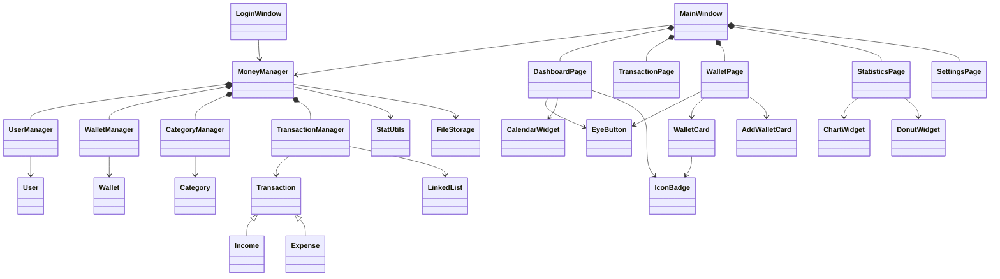

# Giải thích kiến trúc và bảo vệ đồ án PBL2

Ứng dụng dùng C++17 cho nghiệp vụ và Qt 6 Widgets cho giao diện. `src/core/` biên dịch thành thư viện `core` độc lập; `src/ui/` gọi `MoneyManager` và trình bày dữ liệu. `tests/test_console.cpp` kiểm tra core mà không cần Qt.

## Sơ đồ lớp hiện tại

`LinkedList<T>` cài đặt danh sách liên kết đơn và selection sort. `TransactionManager` sở hữu các đối tượng `Transaction*` trong danh sách chính; danh sách lọc chỉ tham chiếu đến chúng. `Income` và `Expense` ghi đè `getSignedAmount()`, nên số dư ví được cập nhật đúng dấu. `FileStorage` đọc/ghi dữ liệu văn bản; `UserManager` quản lý xác thực.

## Quy ước mã nguồn

API hiện có và các slot `on_<objectName>_<signal>` giữ tên ổn định để Qt và các trang gọi được. Hàm nội bộ gần nghiệp vụ có thể dùng tiếng Việt không dấu, chẳng hạn `cungThangNam`, `congChiDanhMuc`, `ngayTangDan`; tên lớp và thuật ngữ Qt/C++ vẫn dùng tiếng Anh. Tên hàm mô tả đúng một việc, tham số có nghĩa rõ ràng. Chú thích giải thích quy tắc hoặc quyền sở hữu bộ nhớ, không lặp lại từng dòng lệnh.

Mỗi lớp trong `src/core/` được tổ chức tinh gọn theo đúng chuẩn OOP với 1 cặp file `.h` và `.cpp` (ví dụ `MoneyManager`, `TransactionManager`, `WalletManager`, `CategoryManager`, `UserManager`, `FileStorage`, `StatUtils`). Riêng `file_storage_internal.h` được giữ lại tối giản để chứa `struct RecordFields` và khai báo `tachTruong()`, phục vụ trực tiếp cho ca kiểm thử độc lập trong `tests/test_console.cpp` (bước 4.2) mà không làm lộ chi tiết phân tách dòng văn bản ra header công khai `file_storage.h`. Khi sửa giao dịch, kiểm tra ví và loại danh mục trước khi tạo danh mục mới. `TransactionManager::applyToWallet` dùng `getSignedAmount()` của `Income`/`Expense` để cộng hoặc trừ số dư. Bất biến nghiệp vụ: mọi thao tác thêm/sửa/xóa giao dịch đều qua bộ kiểm tra lịch sử (`validateWalletTimeline`), từ chối nếu làm số dư bất kỳ ví nào âm ở bất kỳ mốc thời gian nào.

Core tự cài `LinkedList` và Selection Sort cho phần cấu trúc dữ liệu của đồ án. Đọc file có tối đa bảy trường nên dùng mảng cố định `RecordFields`, không cần `std::vector`. Thư viện chuẩn còn dùng cho chuỗi, file, thư mục, ngày giờ và định dạng; giao diện cần Qt Widgets, Qt Designer và QPainter. Không thêm thư viện giao diện ngoài Qt.

## Bốn tính chất hướng đối tượng trong mã

| Tính chất | Vị trí |
|---|---|
| Đóng gói | `src/core/model/transaction.h:15` (`private`), `src/core/model/transaction.h:32` (getter/setter) |
| Kế thừa | `src/core/model/income.h:6`, `src/core/model/expense.h:6` |
| Đa hình | `src/core/model/transaction.h:30` (destructor ảo), `src/core/model/transaction.h:46` (virtual), `src/core/manager/transaction_manager.h:12` (`Transaction*`) |
| Trừu tượng | `src/core/model/transaction.h:46`, `src/core/model/transaction.h:50` (hai phương thức thuần ảo) |

## Luồng thêm giao dịch kèm tạo danh mục

1. `TransactionPage` mở `TransactionDialog`, nhận loại giao dịch, ví, ngày, tiền và tên danh mục.
2. Trang tạo `Income` hoặc `Expense`, gọi `MoneyManager::addTransaction(tx, categoryName, categoryType)`.
3. `MoneyManager` kiểm tra con trỏ, tiền, ngày, ví và tên danh mục; sau đó gọi `CategoryManager::findOrCreateCategory`. Tên đã có cùng loại thì dùng lại, tên mới hợp lệ thì tạo danh mục.
4. `TransactionManager::addTransaction` kiểm tra loại danh mục, cập nhật số dư ví theo `getSignedAmount()` rồi lưu giao dịch vào danh sách.
5. Trang gọi `saveAll` và làm mới các trang. Nếu lời gọi thêm thất bại, trang giải phóng `tx`.

## Luồng thống kê dùng chung hàm

`DashboardPage::updateCards` và `StatisticsPage::updateCards` đều gọi `MoneyManager::getMonthlyTotals`. Hàm bọc này gọi `StatUtils::getMonthlyTotals` với danh sách giao dịch hiện hành. `StatUtils::getExpenseByDay` và thống kê danh mục dùng cùng `cungThangNam` với hàm tổng tháng, chỉ cộng khoản chi vào 31 ô ngày và để các ngày thừa bằng 0. Biểu đồ 6 tháng gọi `get6MonthsStats`, mỗi tháng cũng đi qua `getMonthlyTotals`; thống kê danh mục dùng tổng chi từ hàm đó để tính tỷ trọng.

Thanh menu ngang gồm Tổng quan, Giao dịch, Ví tiền, Thống kê và Cài đặt; cả năm nút có `role=nav` và cùng `navButtonGroup`. `WalletCard` là widget riêng, dùng `wallet_card.ui` để hiển thị từng ví và phát tín hiệu chọn ví. `IconBadge` vẽ dấu hiệu nhỏ trên card; `DonutWidget` vẽ cơ cấu chi từ thống kê danh mục của core. Bốn role khai báo trong `.ui`: `primary` cho lưu/thêm, `secondary` cho hủy/sửa, `danger` cho xóa/đăng xuất và `nav` cho menu. `theme.qss` tập trung màu hover, disabled và trạng thái được chọn.

## 10 câu hỏi bảo vệ Phần 1 và 2 câu hỏi giao diện

1. **Vì sao core không include Qt?** Nghiệp vụ C++ biên dịch và được kiểm thử độc lập; Qt chỉ trình bày dữ liệu ở `src/ui/`.
2. **Vì sao dùng LinkedList và Selection Sort?** Để thực hành cấu trúc dữ liệu và thuật toán của học phần; Selection Sort phù hợp bộ dữ liệu nhỏ của đồ án.
3. **Vì sao ví được phép âm?** Khoản chi vượt số dư vẫn phản ánh đúng chi tiêu hoặc khoản nợ; số dư âm được hiển thị màu đỏ.
4. **Vì sao mật khẩu lưu chữ thường?** Đồ án học tập dùng định dạng văn bản local đơn giản. Đây là hạn chế bảo mật; sản phẩm thực tế cần băm có salt và chuyển đổi dữ liệu cũ.
5. **Vì sao tạo danh mục trong form giao dịch?** Người dùng có thể nhập tên mới ngay lúc ghi Thu/Chi; core kiểm tra rồi tạo hoặc dùng lại danh mục cùng loại.
6. **Vì sao Tổng quan và Thống kê gọi cùng một hàm?** Cả hai gọi `MoneyManager::getMonthlyTotals`, tránh hai cách tính tổng tháng khác nhau.
7. **Vì sao tỷ trọng phần trăm không dồn phần dư?** Mỗi danh mục được làm tròn độc lập; tổng có thể là 99% hoặc 101%, phản ánh đúng quy tắc làm tròn đã chọn.
8. **Vì sao cần virtual destructor?** `Income` và `Expense` được quản lý qua `Transaction*`; hủy qua con trỏ lớp cha phải gọi đúng destructor lớp con.
9. **Vì sao dữ liệu tách theo thư mục user?** `data/<username>/` giữ ví, danh mục và giao dịch của từng tài khoản riêng, tránh lẫn khi đổi người đăng nhập.
10. **Lịch tính chi theo ngày thế nào?** `StatUtils::getExpenseByDay` dùng cùng bộ lọc tháng/năm với tổng tháng, cộng riêng Expense vào 31 phần tử; ngày thừa bằng 0.
11. **Vì sao dùng QSS role thay vì style từng nút?** Cùng một loại nút có màu, hover và trạng thái disabled thống nhất; chỉnh một quy tắc sẽ cập nhật mọi form.
12. **Vì sao WalletCard là class riêng?** Mỗi ví cần hiển thị loại, số dư, cảnh báo âm và tín hiệu chọn; class riêng giữ các trang đơn giản và dùng lại một form thẻ.

## Chuyển dữ liệu cũ vào tài khoản admin

Sao lưu thư mục `data/` trước khi chuyển. Đăng xuất và đóng ứng dụng, tạo `data/admin/` nếu chưa có, rồi sao chép ba file `wallets.dat`, `categories.dat`, `transactions.dat` cũ từ gốc `data/` vào `data/admin/`. Giữ nguyên `data/users.dat`; mở lại ứng dụng và đăng nhập admin để đối chiếu số ví, giao dịch và tổng số dư. Không ghi đè dữ liệu đã có trong `data/admin/` nếu chưa sao lưu riêng.

## Kiểm thử

Chạy `./build.bat test` trên Windows để cấu hình, build và chạy `console_test`. Test 1.8a tự tạo dữ liệu trong bộ nhớ, in chi ngày 5 và 20 của tháng 3/2026, đối chiếu tổng 350.000 với tổng chi tháng, kiểm tra tháng rỗng, ngày thừa và tháng 13. Test xóa thư mục dữ liệu tạm sau khi chạy.
