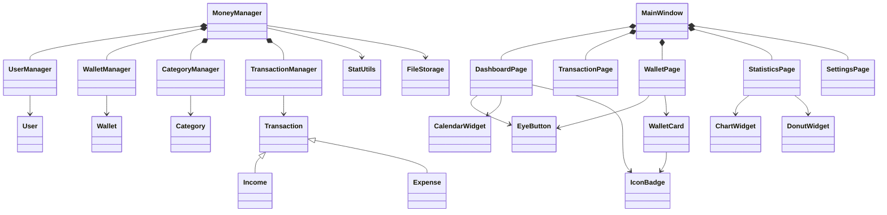

# MoneyManager — PBL2

Ứng dụng quản lý thu chi cá nhân viết bằng C++17 và Qt 6 Widgets. Core ở `src/core/` dùng C++ thuần; GUI ở `src/ui/` dùng các form `.ui` có thể mở trong Qt Designer.

Mã nghiệp vụ dùng `LinkedList` và Selection Sort tự cài để phù hợp mục tiêu học tập PBL2. Tên API và slot Qt được giữ ổn định; một số hàm nội bộ đặt tên tiếng Việt không dấu để diễn đạt quy tắc rõ hơn. Thư viện chuẩn chủ yếu phục vụ chuỗi, file, ngày giờ, phép tính cơ bản và định dạng; không thêm thư viện giao diện ngoài Qt.

## Chạy và build trên Windows

```powershell
.\build.bat test  # build và chạy console_test
.\build.bat       # build GUI và triển khai thư viện Qt
.\run.bat         # mở ứng dụng
```

Máy phát triển dùng Qt `C:/Qt/6.12.0/mingw_64` và MinGW `C:/Qt/Tools/mingw1310_64`. Có thể đặt `QT_ROOT` và `QT_MINGW_ROOT` cho bộ Qt khác phù hợp. File GUI nằm tại `build/qt/MoneyManager.exe`. `build.bat core` chỉ build thư viện C++.

Khi chưa có `data/users.dat`, hãy đăng ký tài khoản trong ứng dụng trước khi đăng nhập. Dữ liệu tài khoản, ví và giao dịch được lưu local trong thư mục `data/` và không được đưa lên Git.

## Dữ liệu demo (dành cho đánh giá và bảo vệ đồ án)

Dự án cung cấp sẵn một bộ dữ liệu mẫu chuẩn hóa trong thư mục `data_demo/` để thầy cô và người chấm có thể trải nghiệm ngay đầy đủ tính năng mà không cần tự nhập liệu từ đầu:

### Cách kích hoạt bộ dữ liệu demo
1. Sao chép nội dung thư mục `data_demo/` vào thư mục `data/` của ứng dụng:
   - File `data_demo/users.dat` sao chép thành `data/users.dat`.
   - Thư mục `data_demo/demo/` sao chép thành `data/demo/`.
2. Khởi chạy ứng dụng (`.\run.bat`).
3. Đăng nhập với tài khoản:
   - **Tên đăng nhập:** `demo`
   - **Mật khẩu:** `123456` *(Lưu ý: Mật khẩu lưu nguyên văn trong users.dat, đây là giới hạn đã biết trong phạm vi đồ án năm 2)*.

### Bộ dữ liệu mẫu bao gồm:
- **3 ví tiền:** Tiền mặt (CASH, số dư hiện tại 430.000 đ), Techcombank (BANK, số dư hiện tại 27.050.000 đ), Ví MoMo (EWALLET, số dư hiện tại 120.000 đ).
- **8 danh mục:** 3 danh mục Thu (Lương tháng, Thưởng dự án, Thu nhập phụ) và 5 danh mục Chi (Tiền phòng trọ, Ăn uống, Đi lại & Xăng xe, Học tập & Sách vở, Mua sắm & Đồ dùng).
- **18 giao dịch:** Phân bổ hợp lý trong tháng 10 và tháng 11/2026, đảm bảo số dư mọi ví không bao giờ âm ở bất kỳ thời điểm nào.
- **Kế hoạch tài chính:** Ngân sách tháng 10.000.000 đ và mục tiêu tiết kiệm "Mua laptop mới".

### 3 tình huống thử nghiệm tính năng ngăn số dư âm:
1. **Thêm giao dịch chi vượt số dư hiện tại:** Chọn ví `Tiền mặt` (hiện có 430.000 đ), nhập một khoản chi `500.000 đ` vào ngày hiện tại -> Hệ thống lập tức từ chối và thông báo số dư không đủ.
2. **Xóa khoản thu trong quá khứ làm âm tương lai:** Vào trang Giao dịch, tìm giao dịch thu `#13` ngày `2026-11-09` (Bán giáo trình cũ +500.000 đ vào ví Tiền mặt). Nhấn nút Xóa -> Hệ thống từ chối xóa vì nếu xóa, số dư của ví Tiền mặt tại các ngày sau đó sẽ bị âm.
3. **Sửa giao dịch chuyển sang ví không đủ tiền:** Chọn giao dịch chi `#14` ngày `2026-11-10` (Đăng ký thi chứng chỉ 800.000 đ đang trừ ở ví Techcombank). Bấm Sửa và đổi ví nhận chi sang `Ví MoMo` (chỉ có 120.000 đ) -> Hệ thống từ chối cập nhật vì ví MoMo không đủ khả năng chi trả.

## Chức năng hiện có

- Đăng nhập, đăng ký, đổi mật khẩu và đăng xuất qua `UserManager`.
- Thêm, sửa, xóa ví; xem tổng số dư và các giao dịch. Giao dịch chi tiêu bị từ chối nếu làm số dư ví âm.
- Thêm, sửa, xóa và lọc giao dịch theo ngày, ví, danh mục, loại; danh mục được chọn từ danh sách hoặc tự động tạo mới khi lưu giao dịch; giao dịch được sắp xếp theo ngày (mới nhất lên đầu).
- Dashboard và trang Statistics dùng chung `MoneyManager::getMonthlyTotals` → `StatUtils::getMonthlyTotals`. Biểu đồ 6 tháng và thống kê danh mục tái dùng tổng tháng; lịch hiển thị chi theo ngày.
- Dữ liệu người dùng được đọc/ghi qua `FileStorage` trong thư mục `data/<username>/` bằng các tệp tin văn bản `.dat` (mỗi dòng một bản ghi, ngăn cách bằng dấu `|`). Dự án hoàn toàn lưu trữ file văn bản tuần tự, không dùng hệ quản trị cơ sở dữ liệu. Khi đọc các tệp `.dat`, các dòng hỏng định dạng (thiếu trường, sai cú pháp) sẽ tự động bị bỏ qua để ứng dụng hoạt động an toàn và không bị crash.

### Cấu trúc phân tầng thực tế
Chương trình được thiết kế theo 5 tầng phân định trách nhiệm rõ ràng:
1. **Tầng Giao diện (UI)**: Xây dựng bằng Qt 6 Widgets, tiếp nhận tương tác người dùng, hiển thị dữ liệu và kích hoạt lệnh qua các cửa sổ (`LoginWindow`, `MainWindow`), trang con (`pages`), hộp thoại (`dialogs`) và widget tái sử dụng (`widgets`).
2. **Tầng Điều phối trung tâm (`MoneyManager`)**: Làm đầu mối kết nối duy nhất giữa giao diện và nghiệp vụ, cung cấp các hàm dịch vụ (`addTransaction`, `updateTransaction`, `getMonthlyTotals`...) cho toàn bộ UI.
3. **Tầng Quản lý nghiệp vụ chuyên trách (`Managers`)**:
   - `UserManager`: Quản lý danh sách người dùng, đăng nhập, đăng ký, đổi mật khẩu. Mật khẩu được lưu nguyên văn (plain text) trong `users.dat` (đây là giới hạn đã biết trong phạm vi đồ án năm 2, chưa áp dụng cơ chế băm bảo mật).
   - `WalletManager`: Quản lý danh sách ví, cập nhật số dư, nạp/rút tiền.
   - `CategoryManager`: Quản lý danh mục thu/chi gắn liền với giao dịch, tự động tái dùng hoặc tạo mới khi lưu giao dịch (không duy trì CRUD danh mục độc lập ngoài UI).
   - `TransactionManager`: Quản lý giao dịch, sắp xếp theo ngày qua Selection Sort, thực thi quy tắc bất biến ngăn số dư âm qua `validateWalletTimeline`.
4. **Tầng Mô hình & Cấu trúc dữ liệu (`Models & Structures`)**:
   - Các thực thể: `User`, `Wallet`, `Category`, và đa hình `Transaction` (`Income` / `Expense`).
   - Cấu trúc dữ liệu tự cài đặt: `LinkedList<T>` và thuật toán Selection Sort.
5. **Tầng Lưu trữ tập tin (`FileStorage`)**: Đọc và ghi dữ liệu ra các file văn bản `.dat` tuần tự theo định dạng `trường1|trường2|...`. Khi nạp dữ liệu, các dòng lỗi/hỏng được bỏ qua mà không làm gián đoạn việc đọc các bản ghi hợp lệ khác.

### Thống kê tệp tin mã nguồn
- **Mã nguồn UI (66 tệp)**:
  - Thư mục gốc `src/ui/`: 17 tệp (`main.cpp`, `main_window`, `login_window`, `gui_helpers`, 3 cặp icon `gui_icons_*`, `theme.qss`, `resources.qrc`).
  - Thư mục `src/ui/pages/`: 16 tệp (5 trang: `dashboard`, `transaction` [+ table helper], `wallet`, `statistics`, `settings`).
  - Thư mục `src/ui/dialogs/`: 14 tệp (5 hộp thoại: `register`, `wallet`, `transaction`, `day_detail`, `plan`).
  - Thư mục `src/ui/widgets/`: 19 tệp (`wallet_card`, `date_picker_field`, `date_picker_popup`, `calendar_widget`, `chart_widget`, `donut_widget`, `month_picker_widget`, `eye_button`, `icon_badge`).
- **Mã nguồn Core (23 tệp)**:
  - `src/core/app/`: 2 tệp (`money_manager.h/.cpp`).
  - `src/core/manager/`: 8 tệp (`transaction_manager`, `wallet_manager`, `category_manager`, `user_manager`).
  - `src/core/model/`: 8 tệp (`transaction`, `wallet`, `category`, `user`).
  - `src/core/storage/`: 2 tệp (`file_storage.h/.cpp`).
  - `src/core/structure/`: 1 tệp (`linked_list.h`).
  - `src/core/utils/`: 2 tệp (`utils.h/.cpp`).

## Sơ đồ lớp



Luồng thêm giao dịch: `TransactionDialog` nhận tên danh mục → `TransactionPage` gọi `MoneyManager::addTransaction` → `CategoryManager::findOrCreateCategory` dùng danh mục có sẵn hoặc tạo mới → `TransactionManager` cập nhật ví và lưu giao dịch → trang ghi file và làm mới dữ liệu. Chi tiết kiến trúc, luồng thống kê và 10 câu hỏi bảo vệ ở [GIAI_THICH.md](GIAI_THICH.md). Bảng giải mã dữ liệu chi tiết và cấu trúc tệp .dat xem tại [docs/DU_LIEU.md](docs/DU_LIEU.md).

Tổng quan và Thống kê cùng gọi `MoneyManager::getMonthlyTotals`; lịch gọi `getExpenseByDay` và biểu đồ gọi `get6MonthsStats`. `EyeButton` chỉ ẩn/hiện số dư.

## Chuyển dữ liệu cũ

Sao lưu `data/`, đóng ứng dụng, rồi sao chép các file ví, danh mục và giao dịch của tài khoản vào `data/<username>/` cùng tên. Giữ `data/users.dat` ở gốc. Chỉ ghi đè dữ liệu sau khi đã sao lưu; đăng nhập bằng tài khoản của bạn và đối chiếu số liệu. Không cần sửa file dữ liệu bằng tay.

## Form Qt Designer

| Thành phần | Form | Mã xử lý |
|---|---|---|
| Đăng nhập | `src/ui/login_window.ui` | `src/ui/login_window.cpp` |
| Đăng ký | `src/ui/dialogs/register_dialog.ui` | `src/ui/dialogs/register_dialog.cpp` |
| Cửa sổ chính | `src/ui/main_window.ui` | `src/ui/main_window.cpp` |
| Tổng quan | `src/ui/pages/dashboard_page.ui` | `src/ui/pages/dashboard_page.cpp` |
| Giao dịch | `src/ui/pages/transaction_page.ui` | `src/ui/pages/transaction_page.cpp`, `src/ui/pages/transaction_page_table.cpp` |
| Ví tiền | `src/ui/pages/wallet_page.ui` | `src/ui/pages/wallet_page.cpp` |
| Thống kê | `src/ui/pages/statistics_page.ui` | `src/ui/pages/statistics_page.cpp` |
| Cài đặt | `src/ui/pages/settings_page.ui` | `src/ui/pages/settings_page.cpp` |
| Hộp thoại giao dịch | `src/ui/dialogs/transaction_dialog.ui` | `src/ui/dialogs/transaction_dialog.cpp` |
| Hộp thoại ví | `src/ui/dialogs/wallet_dialog.ui` | `src/ui/dialogs/wallet_dialog.cpp` |
| Chi tiết giao dịch trong ngày | `src/ui/dialogs/day_detail_dialog.ui` | `src/ui/dialogs/day_detail_dialog.cpp` |
| Thẻ ví | `src/ui/widgets/wallet_card.ui` | `src/ui/widgets/wallet_card.cpp` |

Các widget tự vẽ hoặc custom control (`CalendarWidget`, `ChartWidget`, `DonutWidget`, `DatePickerField`, `DatePickerPopup`, `MonthPickerWidget`, `EyeButton`, `IconBadge`, `WalletCard`) nằm trong `src/ui/widgets/`. Thanh điều hướng ngang có năm mục (Tổng quan, Giao dịch, Ví tiền, Thống kê, Cài đặt). Giữ các `objectName` có kết nối tín hiệu hoặc được mã C++ truy cập. Các file `ui_*.h` được sinh tự động trong `build/`, không sửa trực tiếp.

Các nút khai báo thuộc tính động `role` ngay trong `.ui`: `primary` cho thao tác chính, `secondary` cho thao tác phụ, `danger` cho xóa/đăng xuất, `nav` cho năm mục menu. `theme.qss` định màu mặc định, hover, chọn và disabled dùng chung. Hộp thoại và trang đăng nhập dùng nền trắng, trang nội dung dùng nền xanh băng `#EFF6FF`.

## Kiểm thử và thư mục tạm

`tests/test_console.cpp` kiểm tra các nghiệp vụ core, trong đó có bước 1.8a về tổng chi từng ngày. Dữ liệu test phát sinh dưới `build/`; `.gitignore` bỏ qua `build/`, `test_*_data/` và thư mục giao diện cũ. `src/core/` không dùng `#include <Q...>`.
