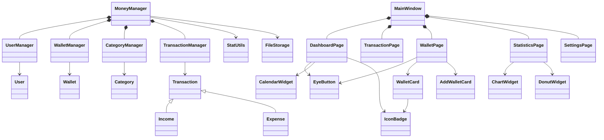

# MoneyManager — PBL2

Ứng dụng quản lý thu chi cá nhân viết bằng C++17 và Qt 6 Widgets. Core ở `src/core/` dùng C++ thuần; GUI ở `src/ui/` dùng các form `.ui` có thể mở trong Qt Designer.

Mã nghiệp vụ dùng `LinkedList` và Selection Sort tự cài để phù hợp mục tiêu học tập PBL2. Tên API và slot Qt được giữ ổn định; một số hàm nội bộ đặt tên tiếng Việt không dấu để diễn đạt quy tắc rõ hơn. Thư viện chuẩn chủ yếu phục vụ chuỗi, file, ngày giờ, phép tính cơ bản và định dạng; không thêm thư viện giao diện ngoài Qt.

## Chạy và build trên Windows

```powershell
.\build.bat test  # build và chạy console_test
.\build.bat       # build GUI và triển khai thư viện Qt
.\run.bat         # mở ứng dụng
```

Máy phát triển dùng Qt `C:/Qt/6.12.0/mingw_64` và MinGW `C:/Qt/Tools/mingw1310_64`. Có thể đặt `QT_ROOT` và `QT_MINGW_ROOT` cho bộ Qt khác phù hợp. File GUI nằm tại `build/qt/MoneyManager.exe`. `build.bat core` chỉ build thư viện C++.

Khi chưa có `data/users.dat`, hãy đăng ký tài khoản trong ứng dụng trước khi đăng nhập. Dữ liệu tài khoản, ví và giao dịch được lưu local trong thư mục `data/` và không được đưa lên Git.

## Chức năng hiện có

- Đăng nhập, đăng ký, đổi mật khẩu và đăng xuất qua `UserManager`.
- Thêm, sửa, xóa ví; xem tổng số dư và các giao dịch. Giao dịch chi tiêu bị từ chối nếu làm số dư ví âm.
- Thêm, sửa, xóa và lọc giao dịch theo ngày, ví, danh mục, loại; có thể nhập tên danh mục mới khi thêm giao dịch.
- Dashboard và trang Statistics dùng chung `MoneyManager::getMonthlyTotals` → `StatUtils::getMonthlyTotals`. Biểu đồ 6 tháng và thống kê danh mục tái dùng tổng tháng; lịch hiển thị chi theo ngày.
- Dữ liệu người dùng được đọc/ghi qua `FileStorage` trong thư mục `data/<username>/`.

### Cấu trúc mã nguồn Core (Chuẩn OOP PBL2)

- Mỗi lớp trong `src/core/` được tổ chức tinh gọn: tương ứng đúng 1 cặp file `.h` và `.cpp` (`MoneyManager`, `TransactionManager`, `WalletManager`, `CategoryManager`, `UserManager`, `FileStorage`, `StatUtils`).
- File `src/core/storage/file_storage_internal.h` được giữ lại tối giản chứa `RecordFields` và `tachTruong()` phục vụ kiểm thử đơn vị lưu trữ trong `tests/test_console.cpp`.

## Sơ đồ lớp



Luồng thêm giao dịch: `TransactionDialog` nhận tên danh mục → `TransactionPage` gọi `MoneyManager::addTransaction` → `CategoryManager::findOrCreateCategory` dùng danh mục có sẵn hoặc tạo mới → `TransactionManager` cập nhật ví và lưu giao dịch → trang ghi file và làm mới dữ liệu. Chi tiết kiến trúc, luồng thống kê và 10 câu hỏi bảo vệ ở [GIAI_THICH.md](GIAI_THICH.md).

Tổng quan và Thống kê cùng gọi `MoneyManager::getMonthlyTotals`; lịch gọi `getExpenseByDay` và biểu đồ gọi `get6MonthsStats`. `EyeButton` chỉ ẩn/hiện số dư.

## Chuyển dữ liệu cũ

Sao lưu `data/`, đóng ứng dụng, rồi sao chép các file ví, danh mục và giao dịch của tài khoản vào `data/<username>/` cùng tên. Giữ `data/users.dat` ở gốc. Chỉ ghi đè dữ liệu sau khi đã sao lưu; đăng nhập bằng tài khoản của bạn và đối chiếu số liệu. Không cần sửa file dữ liệu bằng tay.

## Form Qt Designer

| Thành phần | Form | Mã xử lý |
|---|---|---|
| Đăng nhập | `src/ui/login_window.ui` | `src/ui/login_window.cpp` |
| Đăng ký | `src/ui/dialogs/register_dialog.ui` | `src/ui/dialogs/register_dialog.cpp` |
| Cửa sổ chính | `src/ui/main_window.ui` | `src/ui/main_window.cpp` |
| Tổng quan | `src/ui/pages/dashboard_page.ui` | `src/ui/pages/dashboard_page.cpp` |
| Giao dịch | `src/ui/pages/transaction_page.ui` | `src/ui/pages/transaction_page*.cpp` |
| Ví | `src/ui/pages/wallet_page.ui` | `src/ui/pages/wallet_page*.cpp` |
| Thống kê | `src/ui/pages/statistics_page.ui` | `src/ui/pages/statistics_page.cpp` |
| Cài đặt | `src/ui/pages/settings_page.ui` | `src/ui/pages/settings_page.cpp` |
| Hộp thoại giao dịch | `src/ui/dialogs/transaction_dialog.ui` | `src/ui/dialogs/transaction_dialog*.cpp` |
| Hộp thoại ví | `src/ui/dialogs/wallet_dialog.ui` | `src/ui/dialogs/wallet_dialog.cpp` |

`EyeButton`, `CalendarWidget`, `ChartWidget`, `WalletCard`, `AddWalletCard`, `IconBadge` và `DonutWidget` nằm trong `src/ui/widgets/`. `WalletCard` dùng form `wallet_card.ui`; các trang còn lại cũng giữ bố cục trong form `.ui`. Thanh menu ngang có năm mục, gồm Cài đặt; nút tên tài khoản đã được bỏ. Tên tài khoản hiển thị trong card Tài khoản ở trang Cài đặt. Giữ các `objectName` có kết nối tín hiệu hoặc được mã C++ truy cập. Các file `ui_*.h` được sinh trong `build/`, không sửa trực tiếp.

Các nút khai báo thuộc tính động `role` ngay trong `.ui`: `primary` cho thao tác chính, `secondary` cho thao tác phụ, `danger` cho xóa/đăng xuất, `nav` cho năm mục menu. `theme.qss` định màu mặc định, hover, chọn và disabled dùng chung. Hộp thoại và trang đăng nhập dùng nền trắng, trang nội dung dùng nền xanh băng `#EFF6FF`.

## Kiểm thử và thư mục tạm

`tests/test_console.cpp` kiểm tra các nghiệp vụ core, trong đó có bước 1.8a về tổng chi từng ngày. Dữ liệu test phát sinh dưới `build/`; `.gitignore` bỏ qua `build/`, `test_*_data/` và thư mục giao diện cũ. `src/core/` không dùng `#include <Q...>`.
