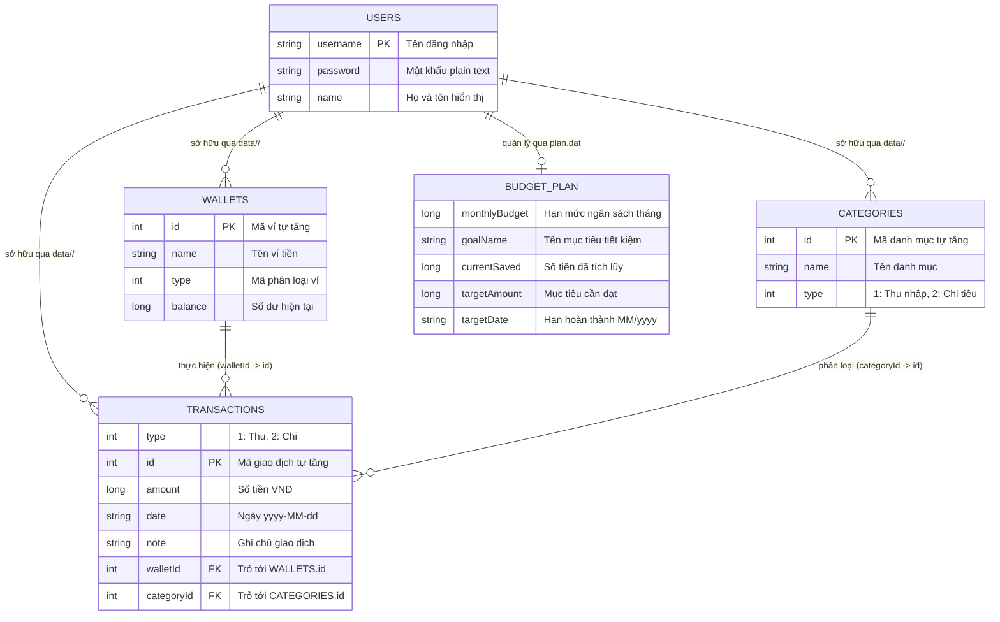

# TÀI LIỆU CẤU TRÚC VÀ DỮ LIỆU LƯU TRỮ TỆP .DAT
**Dự án:** MoneyManager (PBL2 – Đồ án Quản lý thu chi cá nhân)  
**Công nghệ:** C++17, Qt 6 Widgets, Lưu trữ tệp văn bản thuần `.dat`  
**Quy ước định dạng:** Mỗi dòng là một bản ghi, các trường phân tách bởi ký tự gạch đứng `|`

---

## A. TỔNG QUAN LƯU TRỮ TỆP .DAT

Hệ thống MoneyManager **hoàn toàn không sử dụng cơ sở dữ liệu**. Dữ liệu được tổ chức độc lập theo từng tài khoản người dùng trong thư mục `data/`:

| Tên file | Vị trí lưu trữ | Nội dung | Số trường | Ý nghĩa một dòng |
|---|---|---|:---:|---|
| `users.dat` | `data/users.dat` | Danh sách tài khoản người dùng hệ thống | 3 | Một tài khoản người dùng |
| `wallets.dat` | `data/<username>/wallets.dat` | Danh sách ví tiền của người dùng | 4 | Một ví tiền tài chính |
| `categories.dat` | `data/<username>/categories.dat` | Danh sách danh mục thu và chi | 3 | Một danh mục phân loại thu/chi |
| `transactions.dat` | `data/<username>/transactions.dat` | Lịch sử toàn bộ giao dịch thu và chi | 7 | Một giao dịch phát sinh |
| `plan.dat` | `data/<username>/plan.dat` | Hạn mức ngân sách và mục tiêu tiết kiệm | 2 / 5 | Một chỉ số kế hoạch tháng (`budget` hoặc `goal`) |

> **Trạng thái theo dõi Git:** Thư mục `data/` được cấu hình bỏ qua trong `.gitignore` (`data/*.dat`). Chỉ có các tệp `data/.gitignore` và `data/.gitkeep` được theo dõi bởi Git. Dữ liệu thực tế của mỗi máy được giữ độc lập tại máy đó.

---

## B. CHI TIẾT CẤU TRÚC VÀ DỮ LIỆU TỪNG FILE .DAT

### 1. Tệp `data/users.dat` (Danh sách tài khoản)

#### 1.1. Cấu trúc các trường
| STT | Tên trường | Kiểu dữ liệu | Ý nghĩa / Ràng buộc | Ví dụ |
|:---:|---|---|---|---|
| 0 | `username` | `std::string` | Tên đăng nhập duy nhất (viết liền, không dấu) | `admin` |
| 1 | `password` | `std::string` | Mật khẩu tài khoản (lưu nguyên văn dạng văn bản thuần) | `(nguyên văn - không hiển thị)` |
| 2 | `name` | `std::string` | Họ và tên hiển thị đầy đủ của người dùng | `Quản trị viên` |

#### 1.2. Mẫu bản ghi
| Giá trị thực tế | `admin\|(nguyên văn - không hiển thị)\|Quản trị viên` |
|---|---|
| **Ý nghĩa** | Tài khoản `admin`, mật khẩu nguyên văn (không hiển thị trong tài liệu), tên hiển thị `Quản trị viên`. |

#### 1.3. Bảng dữ liệu hiện tại trong file
*(Mật khẩu được che theo nguyên tắc an toàn thông tin đồ án)*

| Tên đăng nhập (`username`) | Mật khẩu (`password`) | Họ và tên hiển thị (`name`) |
|---|---|---|
| `admin` | *(nguyên văn - không hiển thị)* | Quản trị viên |
| `thang` | *(nguyên văn - không hiển thị)* | phan van thang |

---

### 2. Tệp `data/admin/wallets.dat` (Danh sách ví tiền)

#### 2.1. Cấu trúc các trường
| STT | Tên trường | Kiểu dữ liệu | Ý nghĩa / Ràng buộc | Ví dụ |
|:---:|---|---|---|---|
| 0 | `id` | `int` | Mã định danh ví duy nhất ($> 0$, tự tăng `maxId + 1`) | `1` |
| 1 | `name` | `std::string` | Tên ví tiền (không trùng lặp, không chứa `\|`) | `Tiền mặt` |
| 2 | `type` | `int` | Mã phân loại ví (`0`: Tiền mặt, `1`: Ngân hàng, `2`: Khác / Ngân hàng, `3`: Ví điện tử) | `2` |
| 3 | `balance` | `long long` | Số dư hiện tại của ví (VNĐ, có thể âm nếu dữ liệu lịch sử chưa cân đối) | `95750000` |

#### 2.2. Mẫu bản ghi
| Giá trị thực tế | `1\|Tiền mặt\|2\|95750000` |
|---|---|
| **Ý nghĩa** | Ví có ID = 1, tên "Tiền mặt", phân loại 2, số dư hiện tại là 95.750.000 đ. |

#### 2.3. Bảng dữ liệu giải mã đầy đủ
| Mã ví (`id`) | Tên ví (`name`) | Mã loại (`type`) | Loại ví diễn giải | Số dư ban đầu | Số dư hiện tại |
|:---:|---|:---:|---|:---:|:---:|
| 1 | Tiền mặt | 2 | Tiền mặt / Phụ | 500.000 đ | 95.750.000 đ |
| 2 | Techcombank | 2 | Ngân hàng | 5.000.000 đ | 97.500.000 đ |
| 3 | Ví MoMo | 3 | Ví điện tử | 1.000.000 đ | 97.830.000 đ |
| 4 | TP BANK | 2 | Ngân hàng | 100.000.000 đ | 100.000.000 đ |

---

### 3. Tệp `data/admin/categories.dat` (Danh mục thu chi)

#### 3.1. Cấu trúc các trường
| STT | Tên trường | Kiểu dữ liệu | Ý nghĩa / Ràng buộc | Ví dụ |
|:---:|---|---|---|---|
| 0 | `id` | `int` | Mã định danh danh mục ($> 0$, tự tăng `maxId + 1`) | `4` |
| 1 | `name` | `std::string` | Tên danh mục (chuẩn hóa khoảng trắng, không chứa `\|`) | `Ăn uống` |
| 2 | `type` | `int` | Loại danh mục: `1` = Khoản thu (Income), `2` = Khoản chi (Expense) | `2` |

#### 3.2. Mẫu bản ghi
| Giá trị thực tế | `4\|Ăn uống\|2` |
|---|---|
| **Ý nghĩa** | Danh mục ID = 4, tên "Ăn uống", loại `2` là Danh mục Chi tiêu. |

#### 3.3. Bảng dữ liệu giải mã đầy đủ
| Mã DM (`id`) | Tên danh mục (`name`) | Mã loại (`type`) | Phân loại |
|:---:|---|:---:|---|
| 1 | Lương part-time | 1 | Khoản thu |
| 2 | Tiền gia đình gửi | 1 | Khoản thu |
| 3 | Học bổng | 1 | Khoản thu |
| 4 | Ăn uống | 2 | Khoản chi |
| 5 | Tiền trọ & Điện nước | 2 | Khoản chi |
| 6 | Đi lại & Xăng xe | 2 | Khoản chi |
| 7 | Học tập & Giáo trình | 2 | Khoản chi |
| 8 | Mua sắm & Đồ dùng | 2 | Khoản chi |
| 9 | Giải trí & Bạn bè | 2 | Khoản chi |
| 10 | Ăn | 2 | Khoản chi |
| 11 | iphone | 2 | Khoản chi |
| 12 | Lương | 1 | Khoản thu |

---

### 4. Tệp `data/admin/plan.dat` (Kế hoạch & Mục tiêu)

#### 4.1. Cấu trúc các trường
- Dòng ngân sách: `budget|<monthlyBudget>`
- Dòng mục tiêu: `goal|<goalName>|<currentSaved>|<targetAmount>|<targetDate>`

#### 4.2. Bảng dữ liệu giải mã
| Loại chỉ tiêu | Trường 1 | Trường 2 | Trường 3 | Trường 4 | Ý nghĩa |
|---|---|---|---|---|---|
| `budget` | 10.000.000 đ | - | - | - | Hạn mức chi tiêu trong tháng là 10.000.000 đ |
| `goal` | Mua xe máy mới | 8.500.000 đ | 25.000.000 đ | 12/2026 | Mục tiêu mua xe máy 25tr, đã tiết kiệm 8.5tr (34%), hạn tháng 12/2026 |

---

### 5. Tệp `data/admin/transactions.dat` (Lịch sử giao dịch)

#### 5.1. Cấu trúc các trường
| STT | Tên trường | Kiểu dữ liệu | Ý nghĩa / Ràng buộc | Ví dụ |
|:---:|---|---|---|---|
| 0 | `type` | `int` | Loại giao dịch: `1` = Khoản thu (Income), `2` = Khoản chi (Expense) | `1` |
| 1 | `id` | `int` | Mã giao dịch duy nhất ($> 0$, tự tăng `maxId + 1`) | `1` |
| 2 | `amount` | `long long` | Số tiền giao dịch (VNĐ, luôn dương) | `3200000` |
| 3 | `date` | `std::string` | Ngày phát sinh theo chuẩn `yyyy-MM-dd` | `2026-05-05` |
| 4 | `note` | `std::string` | Ghi chú (không chứa ký tự `\|`, có thể để trống) | `Lương tháng` |
| 5 | `walletId` | `int` | Khóa ngoại trỏ tới `wallets.dat (id)` | `2` |
| 6 | `categoryId` | `int` | Khóa ngoại trỏ tới `categories.dat (id)` | `1` |

#### 5.2. Mẫu bản ghi
| Giá trị thực tế | `1\|1\|3200000\|2026-05-05\|Lương tháng\|2\|1` |
|---|---|
| **Ý nghĩa** | Giao dịch Thu (`1`), ID=1, số tiền 3.200.000 đ, ngày 05/05/2026, ghi chú "Lương tháng", vào ví Techcombank (`2`), danh mục "Lương part-time" (`1`). |

#### 5.3. Bảng dữ liệu giải mã toàn bộ 34 giao dịch
| Mã | Loại | Số tiền (VNĐ) | Ngày phát sinh | Ghi chú | Ví thanh toán | Danh mục |
|:---:|:---:|---:|:---:|---|---|---|
| 1 | Khoản thu | 3.200.000 | 05/05/2026 | Lương tháng | [2] Techcombank | [1] Lương part-time |
| 2 | Khoản chi | 1.500.000 | 08/05/2026 | Tiền phòng trọ | [2] Techcombank | [5] Tiền trọ & Điện nước |
| 3 | Khoản chi | 650.000 | 12/05/2026 | Tiền ăn uống | [1] Tiền mặt | [4] Ăn uống |
| 4 | Khoản chi | 120.000 | 22/05/2026 | Chi tiêu sinh hoạt | [3] Ví MoMo | [6] Đi lại & Xăng xe |
| 5 | Khoản thu | 4.000.000 | 05/06/2026 | Lương tháng | [2] Techcombank | [1] Lương part-time |
| 6 | Khoản thu | 2.500.000 | 15/06/2026 | Hỗ trợ/Học bổng | [2] Techcombank | [2] Tiền gia đình gửi |
| 7 | Khoản chi | 1.500.000 | 08/06/2026 | Tiền phòng trọ | [2] Techcombank | [5] Tiền trọ & Điện nước |
| 8 | Khoản chi | 900.000 | 12/06/2026 | Tiền ăn uống | [1] Tiền mặt | [4] Ăn uống |
| 9 | Khoản chi | 1.200.000 | 22/06/2026 | Chi tiêu sinh hoạt | [3] Ví MoMo | [7] Học tập & Giáo trình |
| 10 | Khoản thu | 3.500.000 | 05/07/2026 | Lương tháng | [2] Techcombank | [1] Lương part-time |
| 11 | Khoản thu | 1.800.000 | 15/07/2026 | Hỗ trợ/Học bổng | [2] Techcombank | [2] Tiền gia đình gửi |
| 12 | Khoản chi | 1.500.000 | 08/07/2026 | Tiền phòng trọ | [2] Techcombank | [5] Tiền trọ & Điện nước |
| 13 | Khoản chi | 750.000 | 12/07/2026 | Tiền ăn uống | [1] Tiền mặt | [4] Ăn uống |
| 14 | Khoản chi | 600.000 | 22/07/2026 | Chi tiêu sinh hoạt | [3] Ví MoMo | [8] Mua sắm & Đồ dùng |
| 15 | Khoản thu | 5.200.000 | 05/08/2026 | Lương tháng | [2] Techcombank | [1] Lương part-time |
| 16 | Khoản chi | 1.500.000 | 08/08/2026 | Tiền phòng trọ | [2] Techcombank | [5] Tiền trọ & Điện nước |
| 17 | Khoản chi | 1.100.000 | 12/08/2026 | Tiền ăn uống | [1] Tiền mặt | [4] Ăn uống |
| 18 | Khoản chi | 700.000 | 22/08/2026 | Chi tiêu sinh hoạt | [3] Ví MoMo | [9] Giải trí & Bạn bè |
| 19 | Khoản thu | 3.800.000 | 05/09/2026 | Lương tháng | [2] Techcombank | [1] Lương part-time |
| 20 | Khoản thu | 2.000.000 | 15/09/2026 | Hỗ trợ/Học bổng | [2] Techcombank | [3] Học bổng |
| 21 | Khoản chi | 1.500.000 | 08/09/2026 | Tiền phòng trọ | [2] Techcombank | [5] Tiền trọ & Điện nước |
| 22 | Khoản chi | 800.000 | 12/09/2026 | Tiền ăn uống | [1] Tiền mặt | [4] Ăn uống |
| 23 | Khoản chi | 350.000 | 22/09/2026 | Chi tiêu sinh hoạt | [3] Ví MoMo | [7] Học tập & Giáo trình |
| 24 | Khoản thu | 3.500.000 | 05/10/2026 | Lương tháng | [2] Techcombank | [1] Lương part-time |
| 25 | Khoản chi | 1.500.000 | 08/10/2026 | Tiền phòng trọ | [2] Techcombank | [5] Tiền trọ & Điện nước |
| 26 | Khoản chi | 450.000 | 12/10/2026 | Tiền ăn uống | [1] Tiền mặt | [4] Ăn uống |
| 27 | Khoản chi | 80.000 | 22/10/2026 | Chi tiêu sinh hoạt | [3] Ví MoMo | [6] Đi lại & Xăng xe |
| 28 | Khoản chi | 100.000 | 30/10/2026 | *(trống)* | [1] Tiền mặt | [4] Ăn uống |
| 29 | Khoản chi | 100.000 | 30/10/2026 | *(trống)* | [3] Ví MoMo | [10] Ăn |
| 30 | Khoản chi | 28.000.000 | 31/10/2026 | *(trống)* | [2] Techcombank | [11] iphone |
| 31 | Khoản chi | 20.000 | 10/11/2026 | bánh mì | [3] Ví MoMo | [4] Ăn uống |
| 32 | Khoản thu | 100.000.000 | 11/11/2026 | *(trống)* | [2] Techcombank | [12] Lương |
| 33 | Khoản thu | 100.000.000 | 11/11/2026 | *(trống)* | [1] Tiền mặt | [12] Lương |
| 34 | Khoản thu | 100.000.000 | 11/11/2026 | *(trống)* | [3] Ví MoMo | [12] Lương |

---

## C. BẢNG QUAN HỆ GIỮA CÁC TỆP DỮ LIỆU

### 1. Bảng khóa tham chiếu
| Tệp nguồn | Trường nguồn | Tệp đích | Trường đích | Bản chất quan hệ | Mô tả quan hệ |
|---|---|---|---|:---:|---|
| `users.dat` | `username` | Thư mục `data/<username>/` | *(Thư mục)* | $1 : N$ | Một người dùng sở hữu toàn bộ các tệp ví, danh mục, giao dịch và kế hoạch riêng biệt |
| `transactions.dat` | `walletId` | `wallets.dat` | `id` | $N : 1$ | Nhiều giao dịch tài chính phát sinh từ một ví tiền cụ thể |
| `transactions.dat` | `categoryId` | `categories.dat` | `id` | $N : 1$ | Nhiều giao dịch được phân loại vào cùng một danh mục thu/chi |

### 2. Sơ đồ lưu trữ file (Entity-Relationship Diagram)

---

## D. BẢNG TỔNG HỢP DỮ LIỆU TÍNH TOÁN BẰNG SCRIPT

*(Toàn bộ các số liệu dưới đây được tính tự động bằng script đọc tệp độc lập, không tính tay)*

### 1. Tổng hợp theo Tháng phát sinh
| Tháng | Số GD | Tổng thu (VNĐ) | Tổng chi (VNĐ) | Chênh lệch (Thu - Chi) |
|:---:|:---:|---:|---:|---:|
| **05/2026** | 4 | 3.200.000 | 2.270.000 | +930.000 |
| **06/2026** | 5 | 6.500.000 | 3.600.000 | +2.900.000 |
| **07/2026** | 5 | 5.300.000 | 2.850.000 | +2.450.000 |
| **08/2026** | 4 | 5.200.000 | 3.300.000 | +1.900.000 |
| **09/2026** | 5 | 5.800.000 | 2.650.000 | +3.150.000 |
| **10/2026** | 7 | 3.500.000 | 30.230.000 | -26.730.000 |
| **11/2026** | 4 | 300.000.000 | 20.000 | +299.980.000 |
| **TỔNG CỘNG** | **34** | **329.500.000** | **44.920.000** | **+284.580.000** |

### 2. Tổng hợp theo Loại giao dịch
Đếm tự động từ `transactions.dat` theo mã trường loại (`1` = Khoản thu, `2` = Khoản chi):

| Loại giao dịch | Mã loại | Số giao dịch | Danh sách mã giao dịch (ID) | Tổng số tiền (VNĐ) | Tỷ trọng dòng tiền |
|---|:---:|:---:|---|---:|:---:|
| **Khoản thu (Income)** | `1` | **12** | 1, 5, 6, 10, 11, 15, 19, 20, 24, 32, 33, 34 | 329.500.000 | 88,0% |
| **Khoản chi (Expense)** | `2` | **22** | 2, 3, 4, 7, 8, 9, 12, 13, 14, 16, 17, 18, 21, 22, 23, 25, 26, 27, 28, 29, 30, 31 | 44.920.000 | 12,0% |
| **TỔNG CỘNG** | - | **34** | Toàn bộ 34 giao dịch | **374.420.000** | **100%** |

### 3. Tổng hợp theo Ví tiền và nguồn gốc Số dư ban đầu

#### Nguồn gốc và phương pháp xác định Số dư ban đầu:
- Trong tệp `wallets.dat`, cấu trúc mỗi dòng gồm 4 trường: `id|name|type|balance`. **Trường thứ 4 (`balance`) lưu SỐ DƯ HIỆN TẠI**, tệp `wallets.dat` **hoàn toàn không có trường riêng lưu số dư ban đầu**.
- Số dư ban đầu của từng ví được **tính ngược** từ số dư hiện tại trong `wallets.dat` và toàn bộ lịch sử giao dịch tương ứng trong `transactions.dat` (theo đúng nguyên lý của hàm `getWalletInitialBalance` trong code nghiệp vụ):
  $$\text{Số dư ban đầu của ví} = \text{Số dư hiện tại (trường 4 wallets.dat)} - \left(\sum \text{Khoản thu của ví} - \sum \text{Khoản chi của ví}\right)$$

#### Bảng tổng hợp chi tiết toàn bộ các ví (kể cả ví chưa phát sinh giao dịch):
| Mã ví | Tên ví | Số GD | Tổng thu (VNĐ) | Tổng chi (VNĐ) | Chênh lệch dòng tiền | Số dư ban đầu (tính ngược) | Số dư hiện tại (`wallets.dat`) |
|:---:|---|:---:|---:|---:|---:|---:|---:|
| 1 | Tiền mặt | 8 | 100.000.000 | 4.750.000 | +95.250.000 | **500.000** | **95.750.000** |
| 2 | Techcombank | 17 | 129.500.000 | 37.000.000 | +92.500.000 | **5.000.000** | **97.500.000** |
| 3 | Ví MoMo | 9 | 100.000.000 | 3.170.000 | +96.830.000 | **1.000.000** | **97.830.000** |
| 4 | TP BANK *(chưa có GD)* | 0 | 0 | 0 | 0 | **100.000.000** | **100.000.000** |
| **TỔNG** | *(Cả 4 ví)* | **34** | **329.500.000** | **44.920.000** | **+284.580.000** | **106.500.000** | **391.080.000** |

> **Kiểm chứng cân đối tài chính:**  
> $$\sum \text{Số dư ban đầu } (106.500.000) + \text{Dòng tiền ròng toàn hệ thống } (284.580.000) = \mathbf{391.080.000\text{ đ}}$$  
> Số liệu khớp chính xác $100\%$ với tổng số dư hiển thị trên toàn bộ các trang giao diện.

### 4. Tổng hợp theo Danh mục thu chi
| Mã DM | Tên danh mục | Loại | Số GD | Tổng tiền phát sinh (VNĐ) | Tỷ trọng trong nhóm |
|:---:|---|:---:|:---:|---:|:---:|
| 1 | Lương part-time | Thu | 6 | 23.200.000 | 7,0% |
| 2 | Tiền gia đình gửi | Thu | 2 | 4.300.000 | 1,3% |
| 3 | Học bổng | Thu | 1 | 2.000.000 | 0,6% |
| 12 | Lương | Thu | 3 | 300.000.000 | 91,1% |
| **Tổng Thu** | - | - | **12** | **329.500.000** | **100%** |
| 4 | Ăn uống | Chi | 8 | 4.770.000 | 10,6% |
| 5 | Tiền trọ & Điện nước | Chi | 6 | 9.000.000 | 20,0% |
| 6 | Đi lại & Xăng xe | Chi | 2 | 200.000 | 0,4% |
| 7 | Học tập & Giáo trình | Chi | 2 | 1.550.000 | 3,5% |
| 8 | Mua sắm & Đồ dùng | Chi | 1 | 600.000 | 1,3% |
| 9 | Giải trí & Bạn bè | Chi | 1 | 700.000 | 1,6% |
| 10 | Ăn | Chi | 1 | 100.000 | 0,2% |
| 11 | iphone | Chi | 1 | 28.000.000 | 62,4% |
| **Tổng Chi** | - | - | **22** | **44.920.000** | **100%** |

---

## E. ĐỐI CHIẾU SỐ LIỆU VỚI GIAO DIỆN VÀ KIỂM THỬ

| Hạng mục đối chiếu | Số liệu tính từ file .dat | Số liệu trên Giao diện / Code kiểm thử | Kết quả đối chiếu |
|---|---|---|:---:|
| **Tổng số giao dịch** | 34 giao dịch | Trang Giao dịch (ảnh chụp): 34 giao dịch | **Khớp 100%** |
| **Số khoản thu (Type = 1)** | 12 giao dịch (ID: 1, 5, 6, 10, 11, 15, 19, 20, 24, 32, 33, 34) | Bộ lọc Thu nhập: 12 giao dịch | **Khớp 100%** |
| **Số khoản chi (Type = 2)** | 22 giao dịch (ID: 2, 3, 4, 7, 8, 9, 12, 13, 14, 16, 17, 18, 21, 22, 23, 25, 26, 27, 28, 29, 30, 31) | Bộ lọc Chi tiêu: 22 giao dịch | **Khớp 100%** |
| **Tổng thu toàn bộ** | 329.500.000 đ | Trang Giao dịch (ảnh chụp): 329.500.000 đ | **Khớp 100%** |
| **Tổng chi toàn bộ** | 44.920.000 đ | Trang Giao dịch (ảnh chụp): 44.920.000 đ | **Khớp 100%** |
| **Thu Tháng 10/2026** | 3.500.000 đ | Trang Tổng quan (ảnh chụp): 3.500.000 đ | **Khớp 100%** |
| **Chi Tháng 10/2026** | 30.230.000 đ | Trang Tổng quan (ảnh chụp): 30.230.000 đ | **Khớp 100%** |
| **Chênh lệch Tháng 10/2026** | -26.730.000 đ | Trang Tổng quan (ảnh chụp): -26.730.000 đ | **Khớp 100%** |
| **Thu Tháng 11/2026** | 300.000.000 đ | Trang Thống kê (`04_statistics.png`): 300.000.000 đ | **Khớp 100%** |
| **Chi Tháng 11/2026** | 20.000 đ | Trang Thống kê (`04_statistics.png`): 20.000 đ | **Khớp 100%** |
| **Số dư Ví 1: Tiền mặt** | 95.750.000 đ | Code (`findById(1)->getBalance()`) & Dialog Thêm GD: 95.750.000 đ | **Khớp 100%** |
| **Số dư Ví 2: Techcombank** | 97.500.000 đ | Code (`findById(2)->getBalance()`) & Dialog Sửa GD: 97.500.000 đ | **Khớp 100%** |
| **Số dư Ví 3: Ví MoMo** | 97.830.000 đ | Code (`findById(3)->getBalance()`) & Trang Ví tiền: 97.830.000 đ | **Khớp 100%** |
| **Số dư Ví 4: TP BANK** | 100.000.000 đ | Code (`findById(4)->getBalance()`) & Trang Ví tiền: 100.000.000 đ | **Khớp 100%** |
| **Tổng số dư toàn bộ 4 ví** | 391.080.000 đ | Code (`walletManager.getTotalBalance()`) & KPI Card: 391.080.000 đ | **Khớp 100%** |

---

## F. GIỚI HẠN ĐÃ BIẾT CỦA CƠ CHẾ LƯU TRỮ

1. **Mật khẩu lưu dạng văn bản thuần (Plain Text):** Tệp `users.dat` lưu mật khẩu nguyên văn không mã hóa/băm (đây là giới hạn đã biết trong phạm vi đồ án học phần năm 2).
2. **Xử lý dòng hỏng:** Khi đọc tệp, hàm `tachTruong` bỏ qua các dòng không đủ số trường hoặc sai định dạng. Khi người dùng thực hiện thao tác lưu (`saveAll`), các dòng hỏng này sẽ bị ghi đè và mất đi vĩnh viễn.
3. **Tính Atomic trên Windows:** Thao tác lưu ghi ra tệp tạm `.tmp` rồi gọi `std::remove` và `std::rename` thay thế. Trên hệ điều hành Windows, thao tác này chưa đảm bảo tính nguyên tử tuyệt đối nếu có tiến trình khác đang khóa tệp.
4. **Thứ tự bản ghi trong file:** Các giao dịch được ghi theo thứ tự thêm vào danh sách liên kết chứ không tự động sắp xếp theo ngày trong file `.dat`. Khi nạp vào bộ nhớ hoặc thống kê lịch sử, hệ thống sẽ tự động sắp xếp lại theo thời gian.

---

## G. NHẬN XÉT DỮ LIỆU DEMO HIỆN TẠI

1. **Giao dịch thử nghiệm bất thường:**
   - Ngày `11/11/2026` có 3 giao dịch nhận lương, mỗi giao dịch đúng $100.000.000\text{ đ}$ vào cả 3 ví (ID 32, 33, 34) với ghi chú trống.
   - Ngày `31/10/2026` có giao dịch chi $28.000.000\text{ đ}$ (ID 30) với danh mục "iphone" và ghi chú trống.
   - Ngày `30/10/2026` có 2 khoản chi $100.000\text{ đ}$ liên tiếp (ID 28, 29) với ghi chú trống.
2. **Danh mục bị phân mảnh:**
   - Có cả danh mục "Lương part-time" (ID 1) và "Lương" (ID 12).
   - Có cả danh mục "Ăn uống" (ID 4) và "Ăn" (ID 10).
3. **Khuyến nghị cho nhóm:** Giữ nguyên dữ liệu hiện tại để đối chiếu bài báo cáo. Khi chuẩn bị buổi bảo vệ chính thức, nhóm có thể tinh chỉnh lại một tập dữ liệu demo sinh viên thực tế hơn (sau khi thống nhất với giảng viên hướng dẫn).
